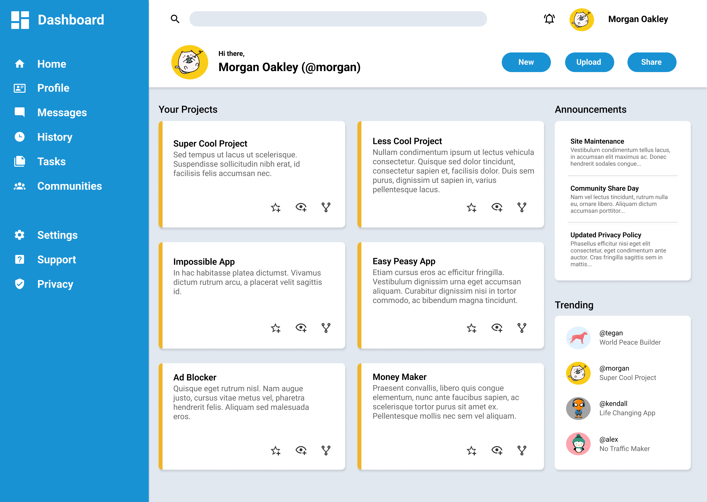

# Admin Dashboard

A responsive and accessible admin dashboard interface built with semantic HTML5, advanced CSS Grid, and Flexbox. This project focuses on multi-column 2D layout architecture, component-level alignment, inline/asset SVG icon integration, and modern visual hierarchy.

Part of [The Odin Project](https://www.theodinproject.com/paths/full-stack-javascript/courses/intermediate-html-and-css) (Intermediate HTML and CSS Course).

---

## 📸 Preview



> **Live Demo:** [View Live Site](https://janf1997-sys.github.io/odin-admin-dashboard/)

---

## 🛠 Features & Learning Goals

- **2D CSS Grid Architecture:** Macro-layout orchestration utilizing CSS Grid (`grid-template-columns`, `grid-template-rows`, or `grid-template-areas`) to define distinct regions for the sidebar, header, project cards grid, and sidebar widgets (Announcements & Trending).
- **Flexbox Micro-Layouts:** Targeted flex containers for UI alignment within headers, search bars, user profile badges, and action buttons on project cards.
- **Iconography & Asset Pipeline:**
  - Scalable Vector Graphics (SVG) integrated for sidebar actions, search utilities, notifications, and card interactions.
  - Dedicated asset structure separating fonts, UI icons, and image avatars.
- **Visual Hierarchy & Design Tokens:**
  - CSS Custom Properties (variables) for consistent color palettes, card elevations/drop shadows, and border radii.
  - Fluid track sizing with `fr` units, `minmax()`, and auto-fill/auto-fit grid placements.
- **Semantic Structure & Accessibility:** Structured with semantic landmarks (`<aside>`, `<header>`, `<main>`, `<section>`, `<article>`) and accessible button/link elements.

---

## 📂 Project Structure

```text
odin-admin-dashboard/
├── assets/
│   ├── fonts/
│   ├── icons/
│   ├── images/
│   └── Template.png
├── index.html
├── style.css
└── README.md
```

---

## 🚀 Tech Stack

- **HTML5:** Semantic landmark architecture, accessible SVG integrations
- **CSS3:** Advanced CSS Grid (macro layout), Flexbox (micro alignment), Custom Properties (CSS variables)
- **Tooling:** WSL2, VS Code, Git/GitHub

---

## ⚙️ Local Development

1. **Clone the repository:**

```bash
git clone [https://github.com/janf1997-sys/odin-admin-dashboard.git](https://github.com/janf1997-sys/odin-admin-dashboard.git)
cd odin-admin-dashboard
```

2. **Run locally:**

- Open the directory in VS Code
- Start with **Live Server** (`Go Live`) directly from the project root.

---

## 📄 License

- Code: [MIT License](https://opensource.org/licenses/MIT)
- Fonts: Distributed under the [SIL Open Font License (OFL)](https://scripts.sil.org/ofl)
